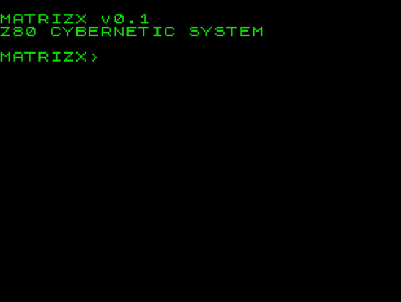

# matrizx
A tiny command-line environment for the ZX Spectrum, written in Z80 assembly.
You can download the `TAP` file from [itch.io](https://xms0g.itch.io/matrizx).



## Features
- Text Terminal — Custom 32×24 character-based terminal.
- Keyboard Input — Direct keyboard matrix scanning.
- Command Interpreter — Simple command parsing and execution.
- Memory Access — Direct memory inspection and manipulation.
- Screen Management — Custom screen clearing, character rendering, and attribute handling.
- Matrix Rain — Animated Matrix-style terminal effect.

| Command  | Description |
|------|-------------|
|`HELP`|Show avaliable commands|
|`CLS` |Clear screen|
|`RAND` |Generate random byte|
|`PEEK`| Read a byte from a memory address|
|`POKE`| Write a value to a memory address|
`RAIN`| Start the Matrix rain animation|

## Technical Details
| Property  | Value |
|------|-------------|
|Target|Sinclair ZX Spectrum|
|Architecture |Zilog Z80|
|Language |Z80 Assembly|
|Assembler| Pasmo|
|Load Address| 0x8000|
|Screen Resolution| 256×192|
|Text Resolution |32×24|
|Video Memory| 0x4000–0x57FF|
|Attribute Memory| 0x5800–0x5AFF|

## Building
```bash
make
```

## License
This project is licensed under the BSD 3-Clause License. See the LICENSE file for details.

